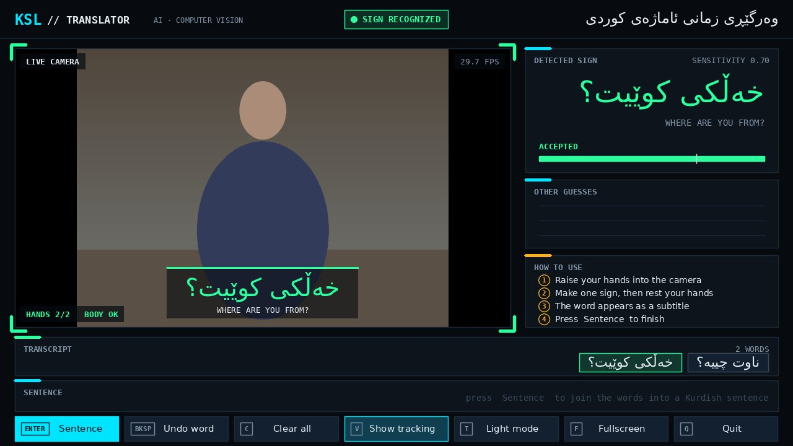

# Kurdish Sign Language Translator

**Project page:** https://noorhans.github.io/kurdish-sign-language-translator/



Team: Noorhan Salah Hassan · Vare Latif — Supervisor: Dr. Jaza Faeq — Computer Engineering, University of Sulaimani.

Webcam → body + hand landmarks (MediaPipe) → GRU sequence model → Kurdish text on screen,
with live subtitles, a running transcript and a one-click "make a sentence" button.

## 1. Install (once per laptop)

Python **3.10–3.12** recommended.

```bash
python -m venv venv
venv\Scripts\activate          # Windows   (macOS/Linux: source venv/bin/activate)
pip install -r requirements.txt
```

The first run downloads two small MediaPipe model files (~10 MB) into `mp_models/`, so be online once.

## 2. Bring your recordings over (no need to record again)

Your recordings are the `data` folder of your old project. Copy the **whole `data` folder** into this
`ksl-translator` folder and replace the empty one. It should look like:

```
ksl-translator/
  data/
    idle/            ← many .npy files
    whats_your_name/
    ...
```

Check it worked:

```bash
python collect.py --status
```

The exhibition uses **25 phrases** (see `phrases.txt`). Phrases you never recorded are simply skipped
when training, so nothing breaks if one is missing.

## 3. Train

```bash
python train.py
```

It prints which phrases it trains on and saves `model/report.txt` (accuracy per phrase, worst first).

## 4. Run the translator

```bash
python app.py                 # dark theme, live camera
python app.py --theme light   # start in light mode
```

Everything works with the **mouse** (buttons along the bottom) or the **keyboard**:

| Button | Key | What it does |
|---|---|---|
| Sentence | ENTER | Turn the recognised words into one Kurdish sentence |
| Undo word | BACKSPACE | Remove the last word |
| Clear all | C | Start over |
| Show / Hide tracking | V | Draw the body + hand tracking lines on the video (off by default) |
| Light / Dark mode | T | Switch theme |
| Fullscreen | F | Fullscreen on/off (great on a big exhibition screen) |
| Quit | Q | Close the app |

Extra keys: `+` / `-` sensitivity, `E` show/hide English.

Too many wrong words → press `+`. Missing real signs → press `-`.

**Sentences:** with an Anthropic API key set, Sentence asks Claude to rewrite the signed words as one
natural Sorani sentence; without a key (or offline) it just joins the words.

```bash
set ANTHROPIC_API_KEY=sk-ant-...      # Windows   (macOS/Linux: export ANTHROPIC_API_KEY=...)
```

The camera picture is shown whole and as-is (nothing cropped, nothing drawn on the person); the tracking runs in the background. Nothing is ever saved.

## Recording more (optional)

```bash
python collect.py --signer noorhan            # continues where you stopped
python collect.py --signer vare --phrase stop # one phrase only
```

SPACE records 30 samples in a row. P pause · R delete last · N/B next/previous · V tracking lines · T theme · Q quit.
Only landmark numbers are saved, never images. To use more phrases later, remove the `#` in front of
them in `phrases.txt`, record them, and train again.

## Exhibition tips

- Same kind of lighting as when you recorded; a plain background behind the signer helps.
- Stand so your hands and shoulders are in view (the **BODY OK** tag shows when they are).
- Make one sign, then rest your hands so it counts as one word.
- Use **Fullscreen** and an external monitor; keep a backup video of the app working.

## Troubleshooting

- **Kurdish shows as boxes:** put any Kurdish-capable `.ttf` (e.g. Noto Sans Arabic) in `fonts/` and name it `font.ttf`. On Windows, Segoe UI is used automatically.
- **Webcam doesn't open:** `python app.py --camera 1`.
- **Slow (< 15 fps):** close other apps; most of the time goes into MediaPipe.

## Files

| File | Purpose |
|---|---|
| `phrases.txt` | The phrase list (25 active) |
| `collect.py` | Record training samples |
| `train.py` | Train + accuracy report |
| `app.py` | Live translator |
| `common.py` | Landmarks, normalisation, Kurdish text |
| `ui.py` | Themes, panels, buttons, camera view |
